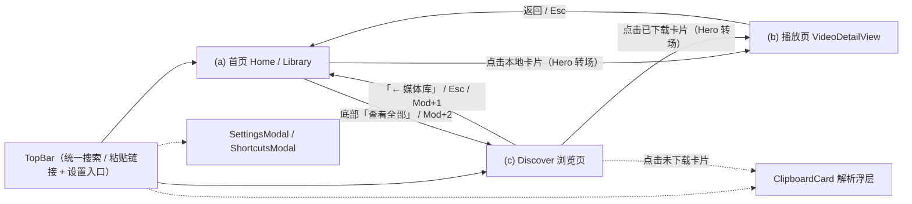

# Ear Desktop 设计文档

状态：已实施并在 `docs/desktop-redesign` 分支持续收敛，涵盖桌面端全局壳层、三大核心页面与视觉规范。

## 1. 设计目标与整体架构

- **极简入口**：去掉左侧 Sidebar 和顶栏页面 Tab；启动即进入 **首页（Home / Library）**。
- **蓝色品牌主题**：所有视频播放控件、字幕拦截条、激活态与下载/选中标识统一使用蓝色主题色（`brand: #2f7cf6`）。
- **三大核心页面**：
  1. **首页（Home / Library）**：本地媒体库主视图 + 底部 Discover 精选条。
  2. **播放页（Player / VideoDetailView）**：全屏精听覆盖层，支持自动左右/上下布局、弱化自隐顶栏、马赛克字幕拦截条与 3D 滚轮字幕。
  3. **Discover 浏览页（DiscoverView）**：按语言与难度等级浏览精选素材的子页面。
- **固定窗口约束**：默认 `1200×800`，最小 `800×560`，记住上次窗口位置与大小（`restoreBounds`）。

---

## 2. 全局壳层与通用浮层

### 2.1 TopBar（顶栏，固定 48px）

- 左侧依次为 Ear 品牌 Logo 按钮（平时静态，鼠标悬浮时播放与 Web 同款的 Loop Resonance 声波共振动效，点击回到首页）与主输入框（最大宽度 `760px`，左对齐），兼顾 **实时搜索** 与 **YouTube 链接解析**：
  - 普通关键字：实时过滤当前页面（首页同时过滤本地条目与活跃下载；Discover 页过滤当前筛选结果）。
  - YouTube 链接（输入、剪贴板自动识别或单实例外部传入）：在输入框正下方弹出与搜索框等宽的 `ClipboardCard`。
  - 空态时显示快捷键提示（`⌘L` / `Ctrl+L`）；若关闭剪贴板自动识别，额外显示手动读取剪贴板图标。
- 右侧仅保留设置齿轮按钮（有新版本时右上角显示蓝色圆点），点击以弹窗打开 `SettingsModal`。

### 2.2 ClipboardCard（链接解析与下载配置浮层）

- 展示来源标识、videoId、封面与时长、标题与频道、当前清晰度与字幕计数摘要。
- 解析中显示骨架屏与 CLI 解析状态；解析完成后支持点选清晰度（`360p / 720p / 1080p / 仅音频`）与字幕轨（单行最多内联展示 3 个优先字幕，超出时点击 `...` 打开下拉 `Select` 选择，选中后自动置入可见项）。
- 选中态、下载主按钮及人工字幕标签统一使用蓝色主题色（`brand`），支持 `Enter` 直接开始下载、`Esc` 收起。

### 2.3 弹窗与反馈

- **SettingsModal**：居中模态框（`620×496`），承载扁平设置列表；点击底部「快捷键」入口时自动关闭设置窗并打开快捷键窗。
- **ShortcutsModal**：居中双栏模态框（`880×620`），按 OS 显示符号（macOS `⌘/⌥`、Linux/Windows `Ctrl/Alt`），支持 `?` / `F1` / `Esc`。
- **ToastHost & DevRibbon**：全局错误提示走 Toast；本地开发模式左上角显示半透明 `DEV` 角标（避免遮挡右上角按钮区域）。

---

## 3. 三大核心页面设计

### (a) 首页（Home / Library）

首页是应用启动后的默认主界面，由上至下分为 **Library 顶栏 + 媒体网格** 与 **底部固定 Discover 精选条** 两部分。

#### Library 顶栏（`LibraryHeader`）

展示在媒体网格上方，采用紧凑两行左对齐结构：

1. **第一行（标题与多选控制）**：
   - **标题与计数**：`Library`（`text-sm font-semibold`）+ 等宽数字计数（搜索时显示 `可见数 / 总数`）。
   - **多选图标开关**：紧邻标题与计数右侧，不显示 `Select` 文案，采用 **列表多选图标（`list-checks`）+ 快捷键徽标 `X`**（激活时呈蓝色柔和态 `border-brand/50 bg-brand-soft text-brand`）。按 `X` 开启多选模式，再按 `X` 取消并退出多选模式（不直接勾选条目）；进入多选模式后统一用 `Space` 选中/取消当前焦点卡片。
   - **全选 / 取消全选（条件显示）**：仅在开启多选操作模式后出现在同一行，展示「全选 / 取消全选」与单键快捷键 `A`（同时兼容 `⌘A` / `Ctrl+A`）；未开启多选模式时不可触发全选。
2. **第二行（下载目录与剩余空间）**：紧挨 `Library` 标题正下方，左对齐展示小号灰字下载目录路径（点击可在系统文件管理器中打开，悬停显示完整路径），并用 `·` 分隔并排展示磁盘剩余 / 总空间（优先通过 `ear storage` 计算，POSIX 环境提供 `df -Pk` 兜底）。

#### 下载中独立区块与媒体网格

- **下载中区块（`ActiveDownloadsSection` / `ActiveDownloadRow`）**：作为独立横条区块固定排在媒体网格上方。
  - 区块头展示总任务数、汇总下载速度与剩余时间（如 `Downloading 1 · 837 KB/s · 0:48 left`）及右侧「全部暂停 / 全部继续」操作。
  - 每条下载任务以横向卡片展示：左侧 `160×90` 封面执行灰转彩逐进度揭示与白色前沿线动画；中间显示标题、清晰度/字幕、蓝色大号百分比、已下载/总大小、实时下载速度、剩余时间及横条进度条；右侧为圆形暂停/继续与取消按钮；完成后播放收起过渡动画。
- **自适应网格**：`grid-template-columns: repeat(auto-fill, minmax(200px, 1fr))`，间距 `16px`，在 `800×560` 最小窗口下保证至少 3 列。
- **已完成卡片（`LibraryCard`）**：视频与音频按添加时间倒序混排。
  - 内容：16:9 封面、右下角时长、音频左上角耳机图标、最多两行标题、标题下方一行元信息（横/竖屏视频播放框图标 + 来源 · 清晰度 · 大小）及异常字幕蓝色轻徽标（仅在「自动字幕」或「无字幕」时出现）。
  - **无卡片独立操作按钮，支持丰富右键菜单**：每张卡片上不放置单独的悬停「⋯」按钮，保持封面干净；键盘按 `X` 开启/退出多选模式，多选模式下用 `Space` 勾选/取消当前焦点卡片，鼠标可点顶部图标进入或退出多选。右键任意首页卡片弹出原生上下文菜单（本地卡片：播放 / 打开文件夹 / 复制链接 / 多选模式 / 删除，多选态下支持单条勾选与全选；底部 Discover 卡片：播放或配置下载 / 打开文件夹 / 复制链接）。
  - 多选模式下点击整卡或右上角勾选圆圈均可勾选/取消。已选卡片是蓝色浅底加右上角蓝色圆勾；键盘光标是中性描边（`ring-foreground`），两者可同时出现。

#### 批量操作胶囊栏（`LibraryBatchBar`）

进入多选模式后，底部悬浮弹出圆角胶囊栏（自动隐藏底部 Discover 条以避免遮挡），每项操作均附单键快捷键提示并实时响应键盘：

- 已选计数蓝色角标、打开文件夹（始终显示，非单选 1 项时 disable，快捷键 `O`）、批量删除（始终显示，未选中时 disable，二次确认弹窗，快捷键 `⌫` / `Del`）、关闭退出（快捷键 `Esc`）。固定按钮集合避免勾选数量变化时工具条宽度跳动闪烁。全选 / 取消全选（`A` / `Mod+A`）归属顶部的 `Library` 行。

#### 底部固定 Discover 精选条

- **Discover 精选条**：固定停靠在首页底部，最多预览 12 条精选素材，带水平滚动列表与显式横向 `Scrollbar`，右上角提供「查看全部 →」进入 Discover 浏览页；冷启动加载中展示等高横向骨架屏（Shell Loading）占位，避免布局跳动。
- 在 **搜索中** 或 **多选模式** 下自动隐藏，把空间留给本地媒体库。
- **空态**：
  - 空媒体库：保留 `LibraryHeader`（含下载目录与磁盘空间），居中提示粘贴链接或从下方精选挑选，底部保留 Discover 条。
  - 搜索无结果：保留 `LibraryHeader`，居中展示空态与「清空搜索」按钮。

---

### (b) 播放页（Player / VideoDetailView）

点击任意本地条目（或已下载的 Discover 条目）后，以全屏覆盖层打开，根据媒体库预先记录的横竖屏尺寸直接将卡片封面以共享元素 Hero 动画平滑放大至目标播放区（竖屏直接展开至左侧竖向舞台、横屏展开至上下/左右舞台，避免先横向再跳转竖向），到位后以透明叠化无缝切入真实视频，关闭时从当前实时布局反向收回。

#### 弱化浮层顶栏（`VideoDetailHeader`）

- 采用 **覆盖视频区的透明渐变浮层**（不挤占视频/字幕高度，左右布局时仅覆盖左侧黑色视频区，避免遮挡右侧字幕栏），背景统一为顶部向下的深色透明渐变（`from-black/75 via-black/35 to-transparent`）。
- **视觉弱化**：标题使用小号常规字重与低对比度浅白文字（`text-xs font-normal text-white/70`），返回按钮同步弱化为轻量文本按钮。
- **播放时自动隐藏**：视频播放中（`paused === false`），若鼠标未悬停在顶部区域且未聚焦返回按钮，顶栏以 `240ms ease-out` 平滑淡出为完全透明；鼠标移至顶部、键盘聚焦或暂停播放时平滑淡入。

#### 响应式布局（视频横竖屏自动识别 + 手动切换）

- **自动识别**：`<Video onLoad>` 读取视频真实分辨率（`size.width / size.height`）；竖版视频（宽高比 `< 0.95`，如 `9:16` 手机视频）在窗口宽度 `>= 600px` 时自动切换为 **左右布局**（右侧双区工作台限宽 `46%`，上限 `560px` 且不超过窗口一半）；横版视频默认固定为 **上下布局**（视频约 `52%`、下方双区精研工作台约 `48%`），不再因大屏拉宽而跳变。
- **无边距黑色沉浸画布**：左右布局与上下布局统一采用无外边距、无圆角缝隙的纯黑底框（`bg-black`），画面内部 `object-contain` 居中，顶部返回栏与底部控制栏均浮层叠放于黑框边缘。
- **手动切换**：底部控制栏最右侧提供布局切换图标按钮（切换左右 / 上下布局），手动切换后锁定当前模式；再次切回自动推荐模式时恢复自动响应。

| 布局模式 | 自动触发条件                                 | 视频区尺寸计算                                                   | 字幕区尺寸计算                                                      |
| -------- | -------------------------------------------- | ---------------------------------------------------------------- | ------------------------------------------------------------------- |
| 左右布局 | 竖版视频（`w/h < 0.95` 且窗口 `>= 600px`）   | 左侧无边距满高黑框（`w - subtitleWidth`，始终 `>= 50%` 窗宽）    | 竖版占 `46%`（`360–560px` 且 `<= 50%`）；内部拆为「上流 + 下卡」    |
| 上下布局 | 横版视频（含大屏）或手动切换上下             | 铺满窗口宽度无边距黑框，高度取 `min(width * 9/16, height * 52%)` | 占据下方剩余高度，内部 `<= 1360px` 居中拆为「左字幕流 + 右精研卡」  |

#### 视频画布与实时马赛克字幕拦截条（`SubtitleBlocker`）

- 点击视频画面任意空白区域切换播放/暂停；暂停时居中显示蓝色半透明圆形播放按钮。纯音频条目展示封面图，不加载拦截条。
- **字幕拦截条**（快捷键 `B`）：覆盖于视频画面之上，用于遮挡内嵌硬字幕。
  - 优先使用实时像素马赛克 Shader（无 Shader 环境自动降级为 Canvas 马赛克）。
  - 悬停或拖动时显示 **蓝色主题色（`brand`）** 边框、8 方向缩放手柄、顶部无缝工具条（遮挡强度滑块、重置位置、关闭）与拖拽坐标提示，位置按视频维度持久化。

#### YouTube 风格视频内底部控制浮层（`VideoPlayerControls`）

直接浮层叠放于视频画面底部（不额外占用视频外高度），所有激活状态与进度指示统一使用蓝色主题色（`brand`）：

- **沉浸自隐与常驻蓝色细进度线**：
  - 播放中且鼠标未悬停或静止 `2.4s` 后，完整控制栏与底部深色渐变平滑淡出（`220ms ease-out`），视频底边保留一条 `3px` 蓝色进度线（`bg-brand` / `bg-white/20`）持续指示播放进度。
  - 暂停、鼠标移入/移动视频区域或键盘聚焦控制栏时，完整控制浮层平滑淡入（底部深色渐变 `from-black/85 via-black/50 to-transparent` 确保浅色/深色主题下清晰可读）。
- **上排进度条**：全宽蓝色进度条（`bg-brand` + 分句刻度线 + 蓝色圆点滑块，悬停加粗）。
- **下排左侧（播放控制）**：上一句、主播放/暂停按钮（蓝色实底）、下一句、单句重复、静音、行内时间显示（`当前 / 总时长`）。
- **下排右侧（精听工具）**：倍速循环、逐句暂停开关、字幕打码开关（默认开启，盲听训练）、字幕拦截条开关（仅视频）、分句长度分段切换（短句 / 适中 / 长句，记住上次选择，选中呈蓝色实底）、左右/上下布局手动切换按钮；视频宽度 `< 680px` 时自动收起次要文案标签，超窄竖屏时控制行自动折行避免截断。

#### 双区字幕精研工作台（`SubtitleStudio` / `SentenceList` / `SentenceRow`）

- 字幕区采用浅层次底面（`bg-well/65`），彻底消除纯白/纯黑大留白感；横屏采用「左字幕时间流 + 右当前句精研卡」，竖屏自动切换为「上字幕流 + 下精研卡」，最小窗（`800×560`）自动隐藏时间戳与笔记框以保持舒适阅读。
- **2D 清爽字幕流（`SentenceRow`）**：去除 3D 倾倒，改为清晰 2D 时间流（时间点 + 原文 + 收藏蓝点），当前句带蓝色左侧指示条与浅蓝高亮（`border-brand bg-brand-soft/80`），自动滚动维持在视口约 35% 位置。
- **当前句精研卡（`ActiveSentenceInspector`）**：顶部为暖琥珀色节奏/语速状态条（点击词块后平滑切为蓝色选词条并支持星标标记）；主体为独立圆角焦点卡片（`bg-card border-line`），支持逐词点击高亮与盲听态逐词揭晓、句级轻笔记输入框，以及底部微动作栏（重听 `R` / 显示打码 `M` / 复制 / 收藏 / 句序与 WPM）。

#### 播放页核心快捷键

| 按键                | 功能                          |
| ------------------- | ----------------------------- |
| `Space`             | 播放/暂停（逐句暂停时下一句） |
| `Left` / `Right`    | 上一句 / 下一句               |
| `R`                 | 重复当前句                    |
| `M` / `B`           | 切换字幕打码 / 字幕拦截条     |
| `[` / `]` / `0`     | 减速 / 加速 / 重置 `1x`       |
| `Up` / `Down`       | 音量增减                      |
| `Alt+1` / `2` / `3` | 短句 / 适中 / 长句分句        |
| `Esc`               | 关闭播放页返回原页面          |

---

### (c) Discover 浏览页（DiscoverView）

用于系统性浏览和筛选精选听力素材的二级页面，复用顶栏搜索与统一封面网格。

- **导航与返回**：
  - 从首页底部 Discover 精选条「查看全部」或 `Mod+2` 进入。
  - 页面左上角固定「`← 媒体库`」返回按钮，有正在下载的任务时按钮内嵌蓝色下载数角标；支持 `Esc` 或 `Mod+1` 返回首页。
- **筛选与刷新**：
  - 语言切换：`English` / `Japanese`（切换语言时等级自动重置为「全部等级」）。
  - 难度等级组：随语言动态展示 **CEFR（`A1–C1`）** 或 **JLPT（`N5–N1`）**，选中态统一为蓝色实底（`bg-brand`）。
  - 支持结合 TopBar 实时关键字搜索，右侧提供手动刷新按钮（`ear discover --refresh`）。
- **卡片交互（`DiscoverCard`）**：
  - 仅展示封面、左上角等级标签、右下角时长与两行标题；已下载条目右上角显示蓝色圆形勾选徽标，下载中条目封面置灰并展示百分比与蓝色底部进度条。
  - 点击卡片：已下载时直接以 Hero 动画进入播放页；未下载时将链接填入 TopBar 并弹出 `ClipboardCard` 配置清晰度与字幕后下载。
- **状态与键盘**：首次加载与手动刷新时以与卡片等比例的骨架屏网格（Shell Loading，`DiscoverCardSkeleton`）占位；覆盖加载失败重试、筛选/搜索无结果（一键重置或清空）状态，支持方向键选择与 `Enter` 确认。

---

## 4. 视觉与主题规范

- **主题色统一**：品牌蓝色 `brand: #2f7cf6` 是全局唯一主强调色，覆盖导航筛选、多选高亮、下载进度、已下载徽标、播放器主按钮、进度条、精听开关、字幕拦截条及当前句高亮。
- **语义色克制**：仅在错误/删除等破坏性操作使用 `danger / destructive`，不把黄色或绿色混用于普通视频播放或激活状态；所有颜色走 `desktop/theme.json` token，不写死十六进制色值。
- **默认深色**：默认深色主题，支持在设置中切换深色 / 浅色 / 跟随系统。

| Token 名称         | 浅色值    | 深色值    | 主要用途                                       |
| ------------------ | --------- | --------- | ---------------------------------------------- |
| `brand`            | `#2f7cf6` | `#2f7cf6` | 主强调色：按钮、进度条、激活态、拦截条、勾选标 |
| `brand-soft`       | `#e8f0fe` | `#13223a` | 柔和蓝色底：多选按钮、精听开关、当前句、徽标   |
| `brand-foreground` | `#ffffff` | `#ffffff` | 蓝色实底上的前景色（文字与图标）               |
| `background`       | `#ffffff` | `#0a0a0a` | 主画布与浮层渐变基色                           |
| `well` / `raised`  | `#f4f4f5` | `#111111` | 输入框、分段控件底槽、悬停底色                 |
| `line` / `border`  | `#e4e4e7` | `#262626` | 细分割线与控件描边                             |
| `danger`           | `#b4473a` | `#d0806f` | 删除确认与下载错误等破坏性/错误语义            |

---

## 5. 设置项与旧配置迁移

`SettingsView` 保持扁平 7 项结构，所有文案跟随界面语言（`en` / `zh`）：

1. 下载目录（附「打开」按钮）
2. 外观：深色 / 浅色 / 跟随系统
3. 界面语言：English / 中文
4. 默认清晰度：360p / 720p / 1080p / 仅音频
5. 剪贴板自动识别开关
6. 版本号与检查更新（接入 `UpdateModal`）
7. 快捷键入口（打开 `ShortcutsModal`）

旧设置迁移（`normalizeSettings`）：`480p` 迁移为 `360p`；丢弃已移除的 `libraryLayout`、`subtitleSize`、`showFooter`、`preferredRate` 等字段；保留 `subtitleBlockerVideos` 与 `subtitleBlockerDefault`。
