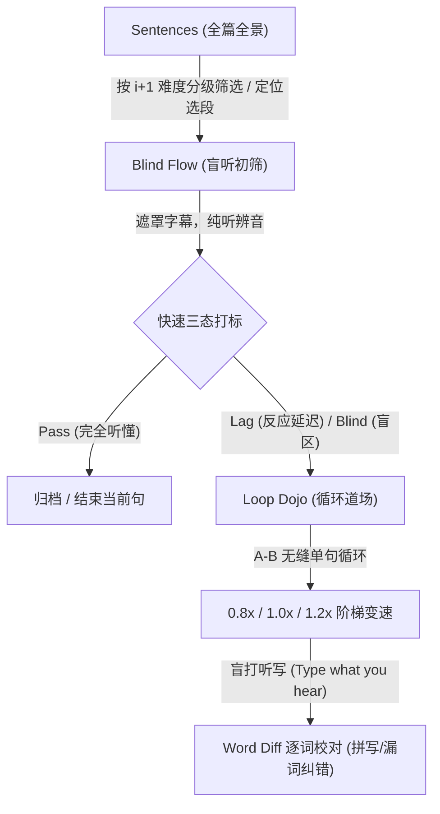

# 听力学习模式设计与工作流 (Modes Design & Learning Workflow)

本文档记录了 Ear 早期针对**可理解输入（Comprehensible Input）**理论设计的全流程听力交互架构，包含 **Sentences（句子全景）**、**Blind Flow（盲听初筛）**、**Loop Dojo（循环精听与听写）** 三个模块的分工与联动机制，供后续功能迭代与交互简化时作为核心设计参考。

---

## 一、核心理念与整体流程

传统听力工具要么是“单纯看双语字幕听全文”（容易产生“看懂了=听懂了”的视觉假象），要么是“从头到尾机械听写”（耗时冗长、挫败感强）。

Ear 将一段音视频切片为句子单元后，构建了一条**漏斗式的高效学习流水线**：



---

## 二、三模式详细职责与设计定义

### 1. Sentences（句子总览与难度分布）

* **定位**：全篇材料的**全景图（Overview / Inspector）**与难度分级导航。
* **数据处理与切分**：
  * YouTube 视频字幕在停顿间隔大于 `650ms` 时自动合并为独立句子（`Sentence`），并在播放边界前后各填充 `±150ms` 缓冲垫，防止吞头吞尾。
  * 根据每句话的语速（WPM，Words Per Minute）按照克拉申（Krashen）的语言习得理论计算难度等级：
    * **`i-1`**（WPM < 145）：低于当前舒适区，发音清晰或语速适中，易于理解。
    * **`i+1`**（145 ≤ WPM ≤ 180）：**黄金可理解输入区**，稍有挑战但最适合吸收进阶。
    * **`Hard`**（WPM > 180）：高速连读或语速极快的爆发段落。
* **主要交互**：
  * 顶部 Tab 提供 `All / i-1 / i+1 / Hard` 快速过滤。
  * 列表显示每句的行号、完整文本、时间戳、难度标签，以及当前在该句上的练习打标状态（绿/灰/红小圆点）。
  * 点击任意一行句子直接跳转至该句的 `Blind Flow` 界面并自动开始播放。

---

### 2. Blind Flow（盲听流 · 快速初筛）

* **定位**：**第一轮泛听/盲听评估（First-pass Screening）**。
* **核心机制**：
  * **字幕遮蔽（Masked Bullets）**：默认将文本遮盖为圆点（`••••`），强制依靠耳朵辨音；按 `R` 或点击字幕可临时揭晓（Reveal），再按一次重新遮盖（Hide）。
  * **快速 3 态打标评估**：
    * `1` 键 **Pass**：一听就完全听懂其含义，发音完全对应上，无需重复练习（绿色）。
    * `2` 键 **Lag**：延迟理解，反应慢了半拍，或者需要扫一眼文字才反应过来（灰色）。
    * `3` 键 **Blind**：完全听不清、没听懂，属于真正的听力盲区（红色）。
  * **时间线与进度反馈**：顶部或底部提供细颗粒度的时间线胶囊，按颜色实时反馈整段视频的掌握度分布。
* **快捷键**：
  * `Space`：播放 / 暂停当前单句切片。
  * `R`：切换字幕遮罩（Reveal / Hide）。
  * `1` / `2` / `3`：打上 Pass / Lag / Blind 标签并自动切到下一句。
  * `←` / `→`：上一句 / 下一句跳转并播放。
* **终局闭环**：
  * 整轮句子初筛打标完毕后，展示 Round Complete 统计面板（Pass / Lag / Blind 计数）。
  * 提供一键引导按钮：`Drill X in Loop Dojo`，自动将所有未达标的句子（Lag + Blind）送入道场。

---

### 3. Loop Dojo（循环道场 · 深度精听与听写）

* **定位**：**第二轮针对难点的刻意练习场（Deliberate Practice / Deep Dive）**。
* **核心机制**：
  * **靶向练习队列（Targeted Queue）**：
    * 遵循 `dojoQueue = sentences.filter(s => tags[s.index] === "lag" || tags[s.index] === "blind")` 规则。
    * **绝不拉取 Pass 句**，将全部注意力集中在盲点与反应迟钝点上。
  * **单句 A–B 无缝循环（Loop A–B）**：
    * 在当前句子的 `startMs` 到 `endMs` 之间无限循环重播，持续磨耳朵。
  * **三档倍速阶梯（0.8× / 1.0× / 1.2×）**：
    * `0.8×`：放慢速度，听清弱读、连读、省音细节。
    * `1.0×`：恢复原速，验证是否真正能跟上正常语速。
    * `1.2×`：超速挑战，强化神经反应速度与听力耐受力。
  * **盲打听写与单词级 Diff（Type-what-you-hear & Word Diff）**：
    * 下方提供输入框供用户盲打听到的英文句子，按回车提交（Submit on Enter）。
    * 对比用户输入与原文字幕（经大小写归一化与标点修剪）：
      * `equal`（绿色）：词汇完全匹配。
      * `mismatch`（红色）：词汇拼写错误或听错。
      * `missing`（黄色/橙色）：漏听漏打的词（常见于弱读介词、冠词）。
      * `extra`（灰色）：多打的冗余词。

---

## 三、数据模型关联

```typescript
// 难度等级 (基于语速 WPM)
type Difficulty = "i-1" | "i+1" | "Hard";

// Blind Flow 打标状态
type BlindTag = "pass" | "lag" | "blind";

// Loop Dojo 消费队列
function dojoQueue(sentences: Sentence[], tags: Record<number, BlindTag>): Sentence[] {
  return sentences.filter((s) => tags[s.index] === "lag" || tags[s.index] === "blind");
}
```

---

## 四、后续简化方向备注

虽然上述三模式构成了完整的“筛选 → 攻坚”闭环，但在桌面端实际使用中存在一定的交互复杂度（例如模式切换频繁、用户心理负担较重）。

若后续进行交互简化，可考虑：
1. **合并视图**：以视频+字幕为主轴，将“盲听”与“逐句循环”内嵌为播放器模式或快捷开关，而非强制拆为三个独立大页面。
2. **轻量化打标**：减少强制打标步骤，提供更随性的单句复读与即时字幕切换。
3. 本文档作为设计初衷与核心算法归档，后续重构时可随时取用其分词切句、WPM 难度划分与 Word Diff 算法。
